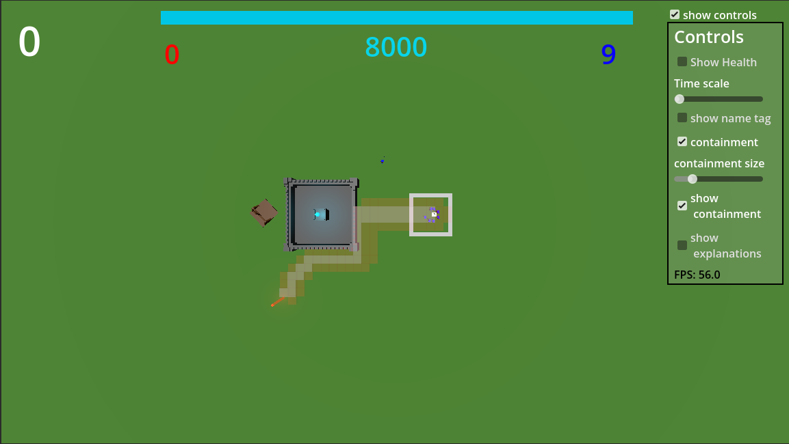

# Minions Tower Defense

This is a strategy game made in Godot, where you have to defend your castle against enemys

## Where can you play it

You can play the game  [here on itch.io](https://tyrannoj.itch.io/minions-tower-defense). The instructions are there or down below

## Features
- menu to start/quit game
- controls tab to change settings
- custom pathfinding for your minions
- Your minions can follow your mouse
- a spawner where you can respawn your minions
- spawners on which enemys spawn (who are placed randomly on the field over time)
- a base with walls that can be attacked
- a catapult which you can turn, load and shoot enemys with
- custom blender models and animations for the players, base and catapult

## Instructions 

### Aim of the game

Your job is to defend your castle from the red minions by controlling your minions, note: if you can download the windows version, it's fullscreen and just looks better.

### Controls

- WASD - move yourself around
- Q - move yourself up
- E - move yourself down
- drag with mouse wheel - mark minions
- drag with left mouse button - marked minions follow you 
- right mouse button - set target for marked minions
- Y - slow time
- T - speed up time
- R - keep the marked players when marking new ones
- F - hold to load catapult, release to fire
- scroll - rotate catapult 

### How to play

- Just press start game, how to play enables a few in game explanations (but not too many as they are all here)
- You can mark your minions (the blue ones) with holding the scrool wheel and dragging
- If you hold left mouse button the marked minions will run to your mouse position
- If you tap right mouse button the minions will pathfind to this point (Note: this is new and can produce errors but should work well)
- If you don't do anything with your minions, they walk around randomly in a confined space, called containment (shown as a green circle)
- If your people see the red people on close range, they will attack them and vice versa
- The enemy will first destroy your castle walls and then the crystal in the middle (you can see its Health on the top)
- Enemys spawn on the outer parts of the border at their spawners, which gradually appear more and more
- You get points by killing enemys or destroying enemy spanwers (which is experimental), they are shown top left
- You can click on the white cube right of the castle to spawn blue minions, you have to mark them and drag them out 
- You have a catapult, with which you can fire on enemys, it takes like half their hp, it doesn't affect your guys
- Sometimes the restart button lags and doesnt respawn enemys, if this happens you have to restart the game, I'll fix that in later versions
- just press the quit button on the end or alt+f4 to quit if you've had enough

### What can you change in the controls

- You can first show/hide the controls
- You can show/hide the health of your minions
- You can slow down time 
- You can show the minions numbers
- You can enable/disable the containment
- You can change the size of the containments
- You can show/hide the containments
- You can hide/show a few explanations in game
- You see the current FPS
- That's about it, if you like, comment your score and if you come from hackclub, thank you for reviewing. 

- P.S. I know it takes rather long to load, this is because of the many areas needed for pathfinding, it will be there eventually tho and you can always download the windows export.

## What are the best features?
- The two path finding programs that both kinda work 
- one of them sends litlle pathfinders out to find the way
- the other one works by having a bunch of areas that check if sth is in them
- That the players can move and the things behind when they go where
- The self made models and animations for the players
- That I find it fun
- That I made most of it myself, I just used AI to look for special methods, cause it's a little faster than the docs

## To do (for future reference)
- make people not get stuck
- let pathfinding check if it can get into somewhere
- look for shortest path
- tutorial
- less loading
